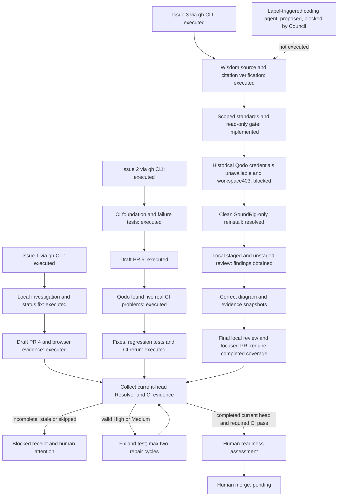

# SoundRig factory: observed paths and remaining gaps

Issue #1 is the status fix; issue #2 adds CI; issue #3 adds standards and quality gates. The diagram deliberately keeps their timelines separate. Source reads made for issue #3 do not retroactively establish Wisdom-first work on issue #1.

The original status implementation reached a draft PR before successful Qodo integration. That catch-up gap is disclosed. The clean reinstall later fixed the connection. Five repository-scoped rules were created after explicit approval and independently read back active; this is manual promotion through Qodo’s rules API, not a claim that AGENTS.md was automatically imported from main.

`ci/review_gate.py` reads GitHub and Qodo, rechecks the PR head and blocks missing, failed, stale, partial or skipped review. It does not approve, dismiss findings, merge, deploy or submit. Unit tests exercise its rejection paths. Its live blocked receipt for a skipped PR #4 review is retained separately from passing CI receipts.

CI failure tests cover private symlinks, SIGTERM cleanup, a resistant descendant, overlapping receipt publication, locked inference, occupied port, timeout and native failure receipts. Native checks use Dummy audio: no human listening claim.

The label-worker proposal was reviewed by six Codex roles and rejected for implementation until trigger provenance, containment, atomic claims, source-bound review and total-deadline requirements are concrete. No job has been installed or fired. Codex role diversity is not independent model-provider evidence. Human merge and daily Discussion submission remain separate pending steps.
